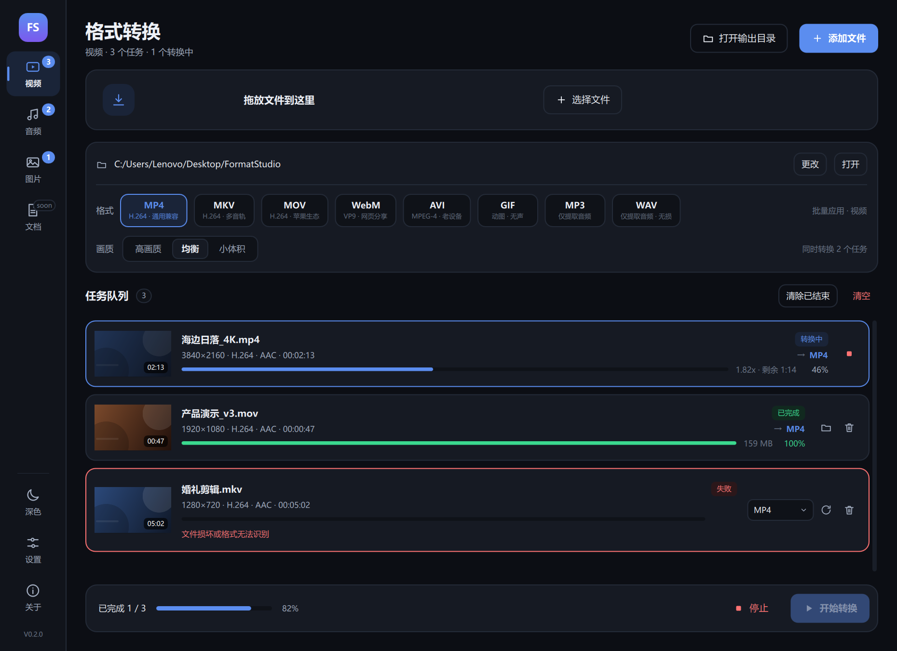
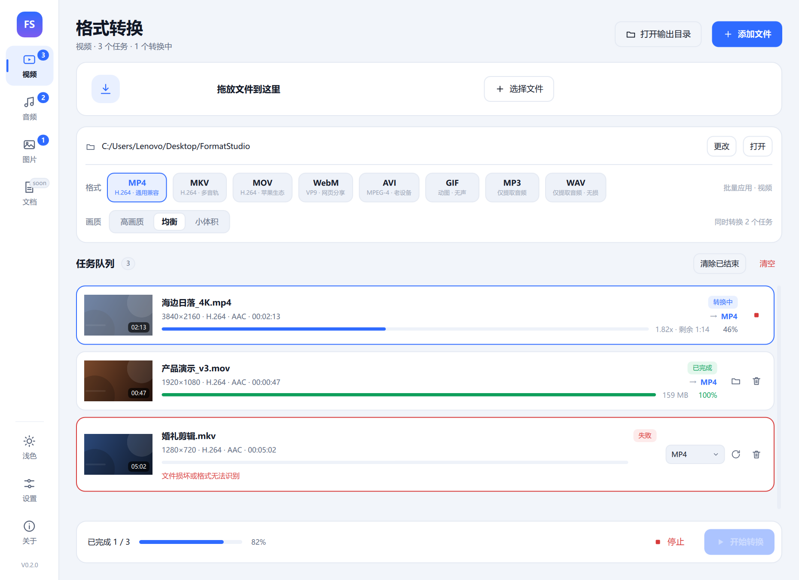
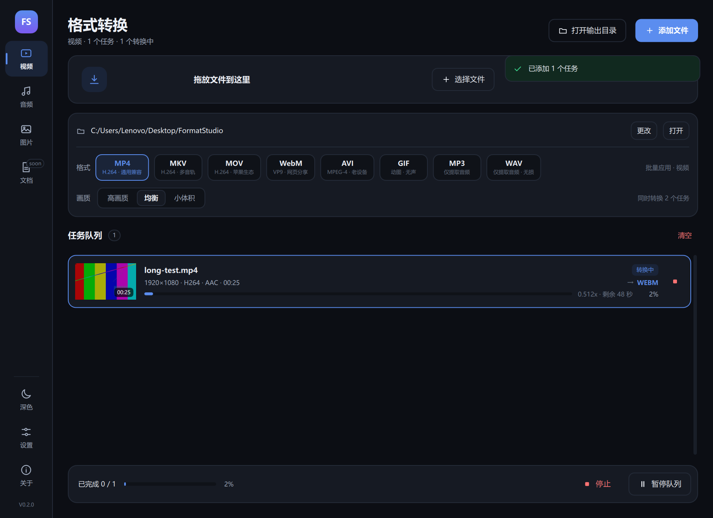
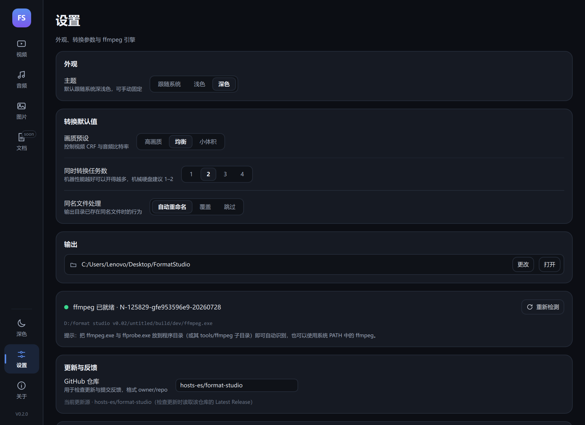
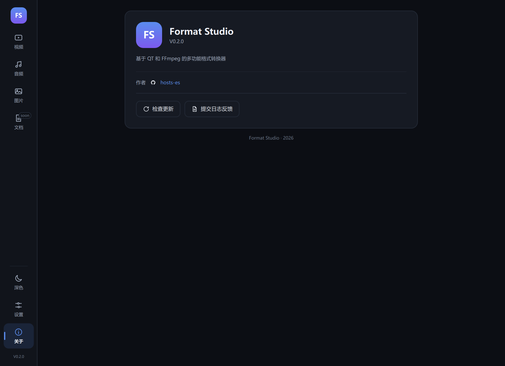
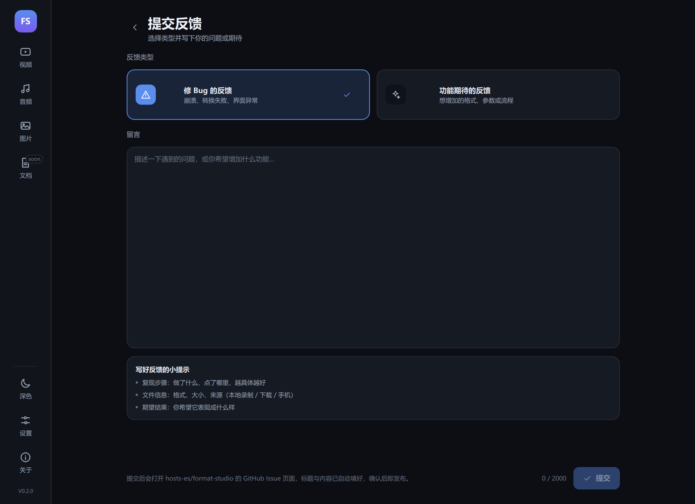
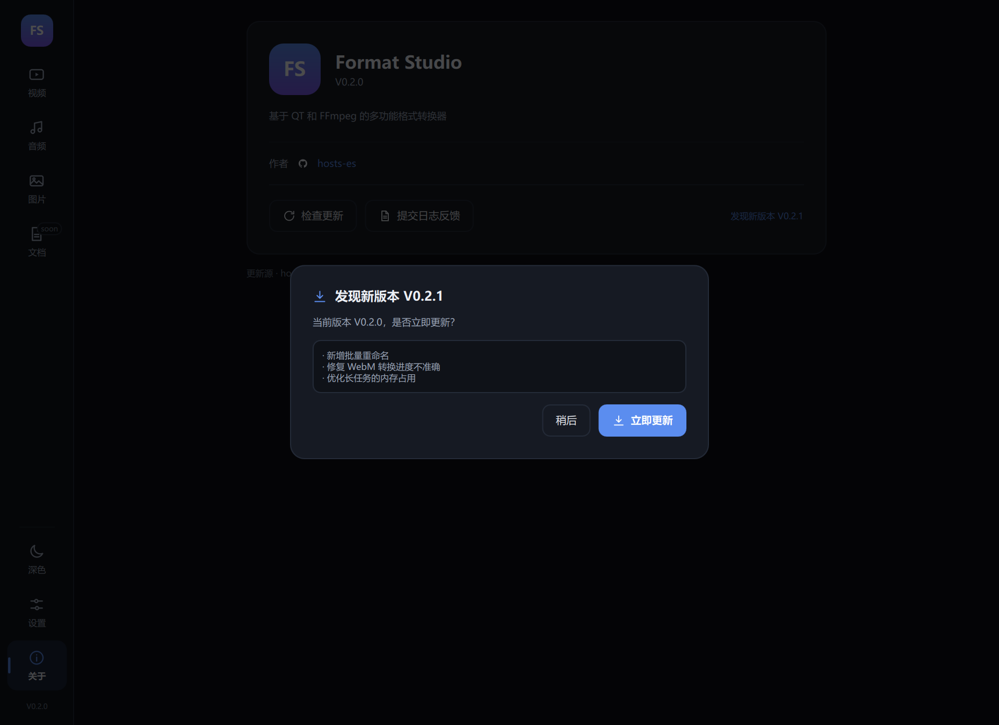

# Format Studio 0.2.0

基于 **Qt 6 / QML** 的批量格式转换工作台，视频、音频、图片共用一条任务队列，底层调用 **FFmpeg** 完成真实转码。



## 功能

- **统一队列**：视频 / 音频 / 图片混排，支持按分类筛选、同时转换 1–4 个任务、暂停排队、停止、失败重试。
- **真实转码**：按目标容器选择编码器（H.264 / VP9 / MPEG-4 / GIF / AAC / MP3 / FLAC / OPUS / WebP…），而不是简单换后缀。
- **进度可见**：解析 FFmpeg `-progress` 输出，显示百分比、倍速与剩余时间。
- **媒体信息**：FFprobe 读取分辨率、编码、时长、采样率，并为视频自动生成缩略图。
- **画质预设**：高画质 / 均衡 / 小体积三档，同时作用于视频 CRF 与音频比特率。
- **批量友好**：拖入文件或整个文件夹（递归扫描）、重复文件自动去重、同名文件可自动重命名 / 覆盖 / 跳过。
- **失败可读**：把 FFmpeg 的报错翻译成可理解的原因，并支持单独重试或取消。
- **深浅色**：侧边栏一键切换或跟随系统，全部配色来自同一套设计 token。
- **按分类工作**：视频 / 音频 / 图片各自一条任务列表，格式、画质、队列操作都只作用于当前分类；拖入其它类型文件会自动切换过去。
- **记忆设置**：输出目录、画质、并发数、主题、默认格式都会保存。
- **检查更新**：读取 GitHub Release 的最新版本号，有新版时弹窗确认、自动下载并启动安装程序。
- **日志反馈**：内置反馈页，选择「修 Bug」或「功能期待」后一键提交到 GitHub Issue（标题与正文自动填好）。

## 界面

| 浅色 | 转换中 |
| --- | --- |
|  |  |

| 设置 | 关于 |
| --- | --- |
|  |  |

| 提交反馈 | 发现新版本 |
| --- | --- |
|  |  |

## 更新与反馈的仓库配置

检查更新与提交反馈都指向 GitHub 仓库，默认 `hosts-es/format-studio`。
在 **设置 → 更新与反馈** 里改成实际仓库（`owner/repo`）即可，无需重新编译。

- 检查更新读取 `releases/latest` 的 `tag_name`，与当前版本（`V0.2.0`）比较；有新版时弹出对话框，确认后下载 Release 中的 `.exe` / `.msi` 并启动安装程序。
- 提交反馈会打开 `https://github.com/<repo>/issues/new`，标题、正文、标签（`bug` / `enhancement`）都已填好，确认后即发布；正文同时复制到剪贴板。

## 构建

要求 Qt 6.5+（本机验证于 Qt 6.11.1 + MinGW 13.1）。

```powershell
cmake -S . -B build/dev -G Ninja ^
      -DCMAKE_BUILD_TYPE=Release ^
      -DCMAKE_PREFIX_PATH="D:/qt6/6.11.1/mingw_64"
cmake --build build/dev
```

Qt Creator：打开 `CMakeLists.txt` 后重新执行 CMake（构建目标已从 `appuntitled` 改名为 `formatstudio`）。

## FFmpeg 依赖

程序需要 `ffmpeg.exe` 与 `ffprobe.exe`，按以下顺序查找：

1. 设置页中手动指定的目录（保存在 QSettings）
2. 可执行文件同目录
3. 可执行文件下的 `tools/ffmpeg`、`tools/ffmpeg/bin`、`ffmpeg` 子目录
4. 系统 `PATH`

也可以用 `-DFS_FFMPEG_DIR="<含 ffmpeg.exe 的目录>"` 在构建时把运行时复制到程序旁：

```powershell
cmake -S . -B build/dev -G Ninja -DFS_FFMPEG_DIR="D:/ffmpeg/bin"
```

## 打包

```powershell
windeployqt --qmldir . build/dev/formatstudio.exe
```

再把 `ffmpeg.exe`、`ffprobe.exe` 及依赖 DLL 复制到同一目录即可。

## 目录结构

```
CMakeLists.txt         构建入口（Qt Quick + Widgets 无关）
main.cpp               应用入口、CLI 选项、图标 provider 注册
converterbackend.h/cpp 转换引擎：探测、调度、进度解析、缩略图、设置
taskmodel.h/cpp        任务模型（QAbstractListModel，role 驱动 QML）
githubservice.h/cpp    检查更新、下载安装包、提交 GitHub Issue
iconprovider.h         用 QSvgRenderer 给单色 SVG 上色
icons/*.svg            28 个线性图标
Theme.qml              设计 token 单例（颜色 / 圆角 / 格式化函数）
Main.qml               窗口、侧边栏、页面栈、全局拖放、更新对话框、Toast
ConvertPage.qml        转换页（拖放区、格式 / 画质、队列、底部操作栏）
TaskCard.qml           任务卡片（缩略图、进度、状态、格式下拉、操作）
SettingsPage.qml       设置页
AboutPage.qml          关于页（作者、检查更新、反馈入口）
FeedbackPage.qml       反馈页（类型选择 + 留言 + 提交）
DocsPage.qml           文档转换占位页（规划中）
StudioButton / IconButton / NavButton / ThemeSwitch / Segmented / FormatChip / DropZone / EmptyState / Toast
```

## 常见问题

### Qt Creator 报 `QQuickStyle file not found` / `No rule to make target ... qrc_icons.cpp`

原因是 Qt Creator 仍指向**旧的构建目录**：缓存还是改造前的（项目名 `untitled`、没有 `QuickControls2` / `Svg` 组件、没有图标资源规则），于是用旧配置去编译新源码。

处理：删掉旧构建目录后重新构建，或在 Qt Creator 里执行 **构建 → 清除 CMake 配置（Clear CMake Configuration）** 再点构建。

```powershell
Remove-Item -Recurse -Force "build\Desktop_Qt_6_11_1_MinGW_64_bit_Debug"
```

### 运行后提示「未检测到 ffmpeg」

把 `ffmpeg.exe`、`ffprobe.exe` 及其 DLL 放到 `formatstudio.exe` 同一目录，或在设置页指定目录。Qt Creator 里按 F5 运行时，程序目录就是构建目录。

## 开发者选项

| 参数 | 说明 |
| --- | --- |
| `--demo` | 载入演示任务（截图 / 走查用） |
| `--screenshot <png>` | 渲染后保存窗口截图并退出 |
| `--theme auto\|light\|dark` | 指定主题 |
| `--size 1240x860` | 指定窗口尺寸 |
| `--page convert\|settings\|about\|docs\|feedback` | 指定初始页面 |
| `--smoke <file;file>` + `--to <ext>` | 冒烟测试：转换完成后按成功/失败返回退出码（0 / 2） |
| `--repo <owner/repo>` | 临时覆盖更新 / 反馈用的仓库 |
| `--check-update` | 执行一次更新检查并打印结果后退出 |
| `--fake-update` | 预览「发现新版本」对话框 |

示例：

```powershell
.\build\dev\formatstudio.exe --smoke "$env:TEMP\test.mp4" --to mkv
```

## 已知限制

- 「暂停」只暂停排队，正在转换的文件会继续完成（FFmpeg 进程无法安全挂起）。
- 文档转换（Word / Excel / PPT / PDF）尚未实现，入口保留为规划页。
- 暂未启用硬件加速（NVENC / QSV / AMF），路线图见 `docs/功能提升方案.md`。
- 原生标题栏跟随系统主题，应用内主题切换只影响窗口内容。
